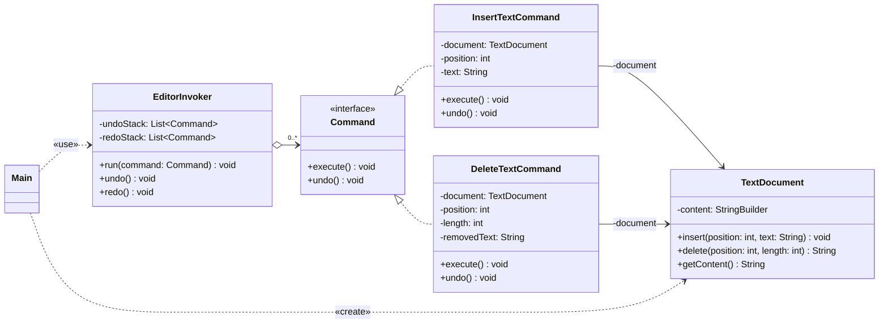
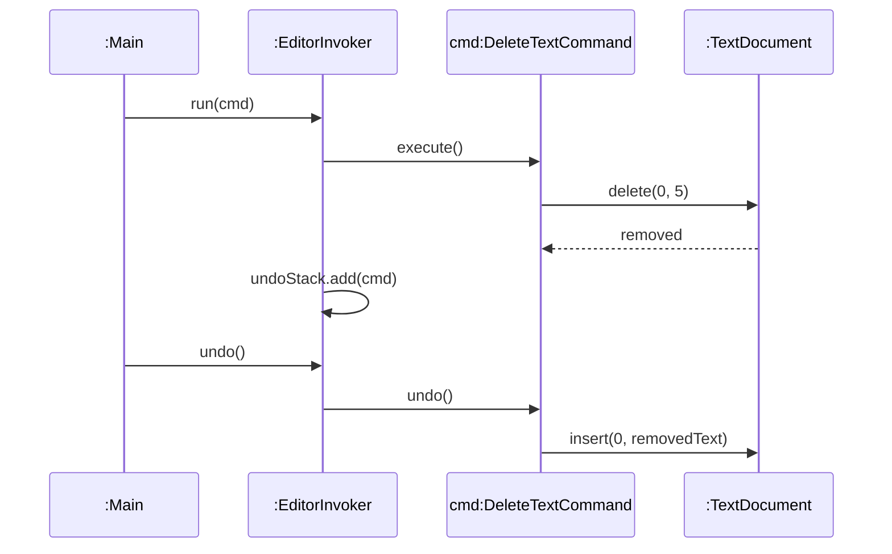

# Padrão de Projeto Command — Editor de texto e transações bancárias

Exemplo em Java do padrão de projeto **Command** (GoF), desenvolvido para o seminário de **Análise e Projeto Orientado a Objetos (APOO)** do Instituto Federal de São Paulo (IFSP), Câmpus São Carlos.

O repositório está dividido em duas partes:

- **`aula`**: o mesmo editor de texto em duas versões. A versão **antes** do padrão concentra toda a lógica em uma classe; a versão **depois** do padrão encapsula cada operação em um objeto. Há também uma extensão com **macros** (`MacroCommand`).
- **`exercicio`**: aplicação do padrão a um domínio diferente, com **transações bancárias** (depósito, saque, transferência e lote de operações), desfazer/refazer e extrato.

**Equipe:** [Eduardo Sorrigotti Tahara] · [Benjamim Silva Manoel]

---

## O padrão Command

O Command é um padrão **comportamental** cuja intenção é encapsular uma requisição como um objeto. Com isso, é possível:

- separar quem **pede** uma operação de quem **sabe executá-la**;
- guardar operações em um histórico para **desfazer** e **refazer**;
- enfileirar, agendar ou registrar operações;
- combinar várias operações em uma só (macros).

### Participantes

| Papel | Responsabilidade | Classe na `aula` | Classe no `exercicio` |
| --- | --- | --- | --- |
| Command | Declara a interface para executar e desfazer uma operação | `Command` | `Command` |
| ConcreteCommand | Liga o receptor a uma ação e guarda o estado para desfazer | `InsertTextCommand`, `DeleteTextCommand`, `MacroCommand` | `DepositCommand`, `WithdrawCommand`, `TransferCommand`, `BatchCommand` |
| Client | Cria os comandos e define o receptor | `Main` | `Main` |
| Invoker | Executa os comandos e mantém o histórico | `EditorInvoker` | `TransactionInvoker` |
| Receiver | Sabe realizar a operação de fato | `TextDocument` | `BankAccount` |

---

## Estrutura do projeto

Os pacotes das versões que usam o padrão têm o nome do papel que cada classe exerce nele.

```
src/main/java/
├── aula/
│   ├── antes/                         # versão sem o padrão
│   │   ├── TextEditor.java
│   │   └── Main.java
│   ├── depois/                        # versão com o padrão Command
│   │   ├── command/
│   │   │   └── Command.java           # interface Command
│   │   ├── concreteCommand/
│   │   │   ├── InsertTextCommand.java
│   │   │   └── DeleteTextCommand.java
│   │   ├── invoker/
│   │   │   └── EditorInvoker.java
│   │   ├── receiver/
│   │   │   └── TextDocument.java
│   │   └── client/
│   │       └── Main.java
│   └── extra/                         # extensão com macros
│       ├── MacroCommand.java
│       └── Main.java
└── exercicio/                         # transações bancárias com o padrão Command
    ├── command/
    │   └── Command.java               # interface Command
    ├── concreteCommand/
    │   ├── DepositCommand.java
    │   ├── WithdrawCommand.java
    │   ├── TransferCommand.java
    │   └── BatchCommand.java
    ├── invoker/
    │   └── TransactionInvoker.java
    ├── receiver/
    │   └── BankAccount.java
    └── client/
        └── Main.java
```

---

## Aula

### Antes: o problema

Na versão `aula.antes`, a classe `TextEditor` recebe o nome da ação como `String` e decide o que fazer com um `switch`. O histórico é uma lista de vetores de `String`, e desfazer exige um segundo `switch` que precisa espelhar o primeiro.

```java
editor.handle("INSERT", 0, "Hello");
editor.handle("DELETE", 0, "6");   // o comprimento é passado como String
editor.handle("UNDO", 0, null);    // parâmetros sem significado
```

Problemas dessa abordagem:

- **Viola o Princípio Aberto-Fechado:** cada nova ação exige alterar `handle()`, `undoLast()` e o formato do histórico.
- **Mistura responsabilidades:** a mesma classe despacha ações, edita o texto e controla o histórico.
- **Histórico sem tipo:** erros de digitação no nome da ação só aparecem em tempo de execução.
- **Difícil de estender:** refazer, macros ou log exigiriam ainda mais `switch`.

### Depois: a solução com Command

Cada operação passa a ser uma classe que implementa a interface `Command`. O `EditorInvoker` executa os comandos e guarda o histórico em duas listas (`undoStack` e `redoStack`, do tipo `List<Command>`, usadas como pilhas) sem saber o que cada comando faz, e o `TextDocument` continua sendo uma classe comum, sem conhecer nenhum comando.

```java
public interface Command {
    void execute();
    void undo();
}
```

```java
TextDocument document = new TextDocument();   // Receiver
EditorInvoker invoker = new EditorInvoker();  // Invoker

invoker.run(new InsertTextCommand(document, 0, "Hello"));
invoker.run(new InsertTextCommand(document, 5, " World"));
invoker.run(new DeleteTextCommand(document, 0, 6));

invoker.undo();
invoker.redo();
```

#### Diagrama de classes



#### Diagrama de sequência (executar e desfazer uma remoção)



### Extra: macros com `MacroCommand`

`MacroCommand` é um comando formado por outros comandos (padrão **Composite**). A macro é executada e desfeita como um único passo, e o desfazer percorre os comandos internos em ordem inversa.

```java
invoker.run(new MacroCommand(List.of(
        new InsertTextCommand(document, 0, "["),
        new InsertTextCommand(document, 6, "]"))));

invoker.undo(); // desfaz a macro inteira
```

Essa funcionalidade foi adicionada **sem alterar** o `EditorInvoker` nem o `TextDocument`: basta criar uma nova classe que implementa `Command`.

---

## Exercício: transações bancárias

O pacote `exercicio` aplica o mesmo padrão a contas bancárias. A conta (`BankAccount`) é o receptor; cada operação financeira é um comando; o `TransactionInvoker` executa, desfaz, refaz e gera o extrato.

Em relação à `aula`, a interface `Command` ganha duas mudanças:

```java
public interface Command {
    boolean execute();        // retorna false se a operação não puder ser feita (ex.: saldo insuficiente)
    void undo();
    String getDescription();  // texto usado no extrato
}
```

- **`execute()` retorna `boolean`:** o `TransactionInvoker` só coloca o comando no histórico se ele foi executado com sucesso.
- **`getDescription()`:** o método `getStatement()` do invoker monta o extrato a partir das descrições dos comandos que estão no histórico.

| Comando | Execução | Desfazer |
| --- | --- | --- |
| `DepositCommand` | deposita o valor na conta | saca o valor |
| `WithdrawCommand` | saca o valor; falha se o saldo for insuficiente | deposita o valor de volta |
| `TransferCommand` | saca da origem e deposita no destino; falha se a origem não tiver saldo | faz o caminho inverso |
| `BatchCommand` | executa vários comandos; se um falhar, desfaz os já executados (tudo ou nada) | desfaz todos em ordem inversa |

`BatchCommand` cumpre o mesmo papel do `MacroCommand` da aula (padrão **Composite**), com a diferença de ser **atômico**: ou todas as operações do lote acontecem, ou nenhuma.

```java
BankAccount alice = new BankAccount("Alice", new BigDecimal("100"));
BankAccount bob = new BankAccount("Bob", new BigDecimal("0"));
TransactionInvoker invoker = new TransactionInvoker();

invoker.run(new DepositCommand(alice, new BigDecimal("50")));
invoker.run(new TransferCommand(alice, bob, new BigDecimal("200"))); // false: saldo insuficiente

invoker.run(new BatchCommand(List.of(
        new TransferCommand(alice, bob, new BigDecimal("100")),
        new TransferCommand(alice, bob, new BigDecimal("100"))))); // false: o lote inteiro é desfeito

invoker.getStatement().forEach(System.out::println);
```

---

## Como executar

**Requisitos:** Java 17 ou superior (o projeto foi configurado com o JDK 26).

### Pelo IntelliJ IDEA

Abra a pasta do projeto e execute o método `main` de uma das classes:

- `aula.antes.Main`
- `aula.depois.client.Main`
- `aula.extra.Main`
- `exercicio.client.Main`

### Pelo terminal

Na raiz do projeto (Linux, macOS ou Git Bash no Windows):

```bash
javac -d out $(find src/main/java -name "*.java")

java -cp out aula.antes.Main
java -cp out aula.depois.client.Main
java -cp out aula.extra.Main
java -cp out exercicio.client.Main
```

### Saídas esperadas

| Classe | Saída |
| --- | --- |
| `aula.antes.Main` | `World` → `Hello World` |
| `aula.depois.client.Main` | `World` → `Hello World` → `World` |
| `aula.extra.Main` | `World` → `[World]` → `World` |

`exercicio.client.Main`:

```
Alice: 150
Transfer of 200 done? false | Alice: 150 | Bob: 0
Batch done? false | Alice: 150 | Bob: 0
Statement:
  Deposit of 50 into Alice
  Transfer of 30 from Alice to Bob
```

---

## Consequências do padrão

**Vantagens**

- Desacopla quem invoca a operação de quem a executa (Princípio da Responsabilidade Única).
- Novos comandos podem ser adicionados sem alterar invocadores nem receptores (Princípio Aberto-Fechado).
- Comandos podem ser guardados em histórico, enfileirados, agendados e registrados em log (como o extrato do `exercicio`).
- Comandos simples podem ser combinados em macros ou lotes.

**Cuidados**

- Cada operação vira uma classe, o que aumenta a quantidade de código.
- Desfazer exige guardar estado suficiente, e operações com efeitos externos (enviar um e-mail, por exemplo) não podem ser realmente desfeitas.
- Históricos longos consomem memória; é comum limitar o tamanho do histórico.

---

## Referências

- GAMMA, E.; HELM, R.; JOHNSON, R.; VLISSIDES, J. *Design Patterns: Elements of Reusable Object-Oriented Software*. Addison-Wesley, 1994.
- FREEMAN, E.; ROBSON, E. *Head First Design Patterns*. 2. ed. O'Reilly, 2020.
- [Refactoring Guru — Command](https://refactoring.guru/design-patterns/command)
