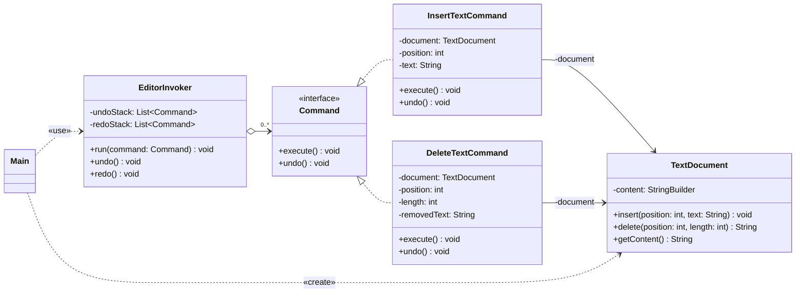
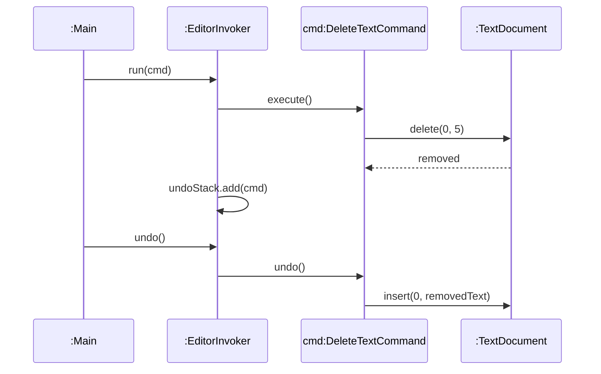

# Padrão de Projeto Command — Editor de texto com desfazer e refazer

Exemplo em Java do padrão de projeto **Command** (GoF), desenvolvido para o seminário de **Análise e Projeto Orientado a Objetos (APOO)** do Instituto Federal de São Paulo (IFSP), Câmpus São Carlos.

O repositório mostra o mesmo editor de texto em duas versões: **antes** do padrão, com toda a lógica concentrada em uma classe, e **depois** do padrão, com cada operação encapsulada em um objeto. Há também uma extensão com **macros** (`MacroCommand`).

**Equipe:** [Eduardo Sorrigotti Tahara] · [Benjamim Silva Manoel]

---

## O padrão Command

O Command é um padrão **comportamental** cuja intenção é encapsular uma requisição como um objeto. Com isso, é possível:

- separar quem **pede** uma operação de quem **sabe executá-la**;
- guardar operações em um histórico para **desfazer** e **refazer**;
- enfileirar, agendar ou registrar operações;
- combinar várias operações em uma só (macros).

### Participantes

| Papel | Responsabilidade | Classe no exemplo |
| --- | --- | --- |
| Command | Declara a interface para executar e desfazer uma operação | `Command` |
| ConcreteCommand | Liga o receptor a uma ação e guarda o estado para desfazer | `InsertTextCommand`, `DeleteTextCommand`, `MacroCommand` |
| Client | Cria os comandos e define o receptor | `Main` |
| Invoker | Executa os comandos e mantém o histórico | `EditorInvoker` |
| Receiver | Sabe realizar a operação de fato | `TextDocument` |

---

## Estrutura do projeto

Os pacotes da versão `depois` têm o nome do papel que cada classe exerce no padrão.

```
src/main/java/
├── antes/                         # versão sem o padrão
│   ├── TextEditor.java
│   └── Main.java
├── depois/                        # versão com o padrão Command
│   ├── command/
│   │   └── Command.java           # interface Command
│   ├── concreteCommand/
│   │   ├── InsertTextCommand.java
│   │   └── DeleteTextCommand.java
│   ├── invoker/
│   │   └── EditorInvoker.java
│   ├── receiver/
│   │   └── TextDocument.java
│   └── client/
│       └── Main.java
└── extra/                         # extensão com macros
    ├── MacroCommand.java
    └── Main.java
```

---

## Antes: o problema

Na versão `antes`, a classe `TextEditor` recebe o nome da ação como `String` e decide o que fazer com um `switch`. O histórico é uma lista de vetores de `String`, e desfazer exige um segundo `switch` que precisa espelhar o primeiro.

```java
editor.handle("INSERT", 0, "Hello");
editor.handle("DELETE", 0, "6");   // o comprimento é passado como String
editor.handle("UNDO", 0, null);    // parâmetros sem significado
```

Problemas dessa abordagem:

- **Viola o Princípio Aberto-Fechado:** cada nova ação exige alterar `handle()`, `undoLast()` e o formato do histórico.
- **Mistura responsabilidades:** a mesma classe despacha ações, edita o texto e controla o histórico.
- **Histórico sem tipo:** erros de digitação no nome da ação só aparecem em tempo de execução.
- **Difícil de estender:** refazer, macros ou log exigiriam ainda mais `switch`.

---

## Depois: a solução com Command

Cada operação passa a ser uma classe que implementa a interface `Command`. O `EditorInvoker` executa os comandos e guarda o histórico sem saber o que cada um faz, e o `TextDocument` continua sendo uma classe comum, sem conhecer nenhum comando.

```java
public interface Command {
    void execute();
    void undo();
}
```

```java
TextDocument document = new TextDocument();   // Receiver
EditorInvoker invoker = new EditorInvoker();  // Invoker

invoker.run(new InsertTextCommand(document, 0, "Hello"));
invoker.run(new InsertTextCommand(document, 5, " World"));
invoker.run(new DeleteTextCommand(document, 0, 6));

invoker.undo();
invoker.redo();
```

### Diagrama de classes



### Diagrama de sequência (executar e desfazer uma remoção)



---

## Extra: macros com `MacroCommand`

`MacroCommand` é um comando formado por outros comandos (padrão **Composite**). A macro é executada e desfeita como um único passo, e o desfazer percorre os comandos internos em ordem inversa.

```java
invoker.run(new MacroCommand(List.of(
        new InsertTextCommand(document, 0, "["),
        new InsertTextCommand(document, 6, "]"))));

invoker.undo(); // desfaz a macro inteira
```

Essa funcionalidade foi adicionada **sem alterar** o `EditorInvoker` nem o `TextDocument`: basta criar uma nova classe que implementa `Command`.

---

## Como executar

**Requisitos:** Java 17 ou superior (o projeto foi configurado com o JDK 26).

### Pelo IntelliJ IDEA

Abra a pasta do projeto e execute o método `main` de uma das classes:

- `antes.Main`
- `depois.client.Main`
- `extra.Main`

### Pelo terminal

Na raiz do projeto (Linux, macOS ou Git Bash no Windows):

```bash
javac -d out $(find src/main/java -name "*.java")

java -cp out antes.Main
java -cp out depois.client.Main
java -cp out extra.Main
```

### Saídas esperadas

| Classe | Saída                             |
| --- |-----------------------------------|
| `antes.Main` | `World` → `Hello World`           |
| `depois.client.Main` | `World` → `Hello World` → `World` |
| `extra.Main` | `World` → `[World]` → `World`     |

---

## Consequências do padrão

**Vantagens**

- Desacopla quem invoca a operação de quem a executa (Princípio da Responsabilidade Única).
- Novos comandos podem ser adicionados sem alterar invocadores nem receptores (Princípio Aberto-Fechado).
- Comandos podem ser guardados em histórico, enfileirados, agendados e registrados em log.
- Comandos simples podem ser combinados em macros.

**Cuidados**

- Cada operação vira uma classe, o que aumenta a quantidade de código.
- Desfazer exige guardar estado suficiente, e operações com efeitos externos (enviar um e-mail, por exemplo) não podem ser realmente desfeitas.
- Históricos longos consomem memória; é comum limitar o tamanho do histórico.

---

## Referências

- GAMMA, E.; HELM, R.; JOHNSON, R.; VLISSIDES, J. *Design Patterns: Elements of Reusable Object-Oriented Software*. Addison-Wesley, 1994.
- FREEMAN, E.; ROBSON, E. *Head First Design Patterns*. 2. ed. O'Reilly, 2020.
- [Refactoring Guru — Command](https://refactoring.guru/design-patterns/command)
